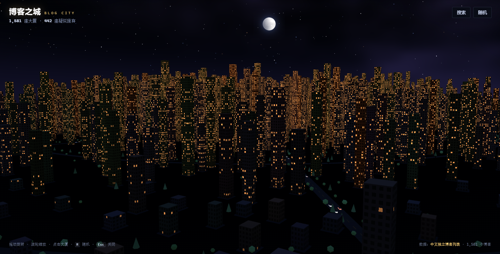
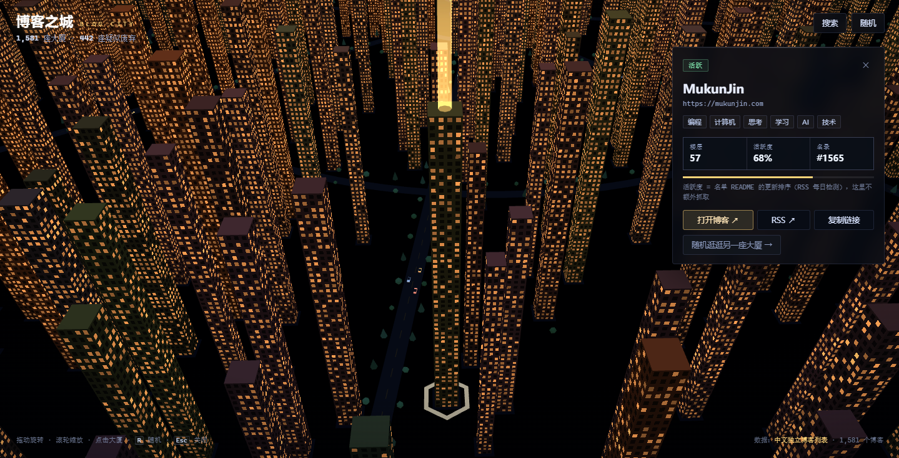

<p align="center">
  
</p>

<h1 align="center">博客之城 · Blog City</h1>

<p align="center">
  <b><a href="https://play.mukunjin.com">play.mukunjin.com</a></b>
</p>

<p align="center">
  <a href="https://react.dev"></a>
  <a href="https://threejs.org"></a>
  <a href="https://vitejs.dev"></a>
  <a href="https://pages.cloudflare.com"></a>
  <a href="LICENSE"></a>
</p>

把[中文独立博客列表](https://github.com/timqian/chinese-independent-blogs)变成一座 3D 像素城市：
**每个博客是一栋楼**，越活跃楼越高、灯越亮，久未更新的缩在城郊。





站点是纯静态的，托管在 **Cloudflare Pages**，没有数据库、没有服务端。

---

## 本地跑起来

```bash
npm install
npm run dev          # http://localhost:3210
```

## 数据从哪来

两份文件放在 `data/` 里，**都提交进仓库**，构建时只读它们、不碰网络：

| 文件 | 是什么 | 谁更新 |
| --- | --- | --- |
| `data/blogs-original.csv` | 上游名单的副本（MIT）：名称、网址、RSS、标签 | `npm run sync` 从 GitHub 拉：CI 用 raw.github（无缓存），本地优先 jsDelivr（raw 在国内常被墙） |
| `data/health.json` | 每篇博客最近发文时间、是否失效、失败原因 | `npm run sync` 拉 `indi.blog/api/blogs.json` |

`src/data/blogs.json` 是两者的合并结果（博客数量随名单变化，代码里不写死）：

```bash
npm run sync     # 拉 CSV + 状态接口，覆盖 data/ 下两份文件，然后重算城市快照
npm run data     # 只重算：data/ 的 CSV + health → src/data/blogs.json（零网络）
```

为什么把 CSV 存进仓库，而不是构建时去拉：

- **可复现**：同一个提交永远生成同一座城市，数字不会因为「今天 CDN 给了哪一版」而变；
- **构建不依赖网络**：Pages 构建只跑本地脚本，CDN 抽风不会让发布失败；
- **看得见**：上游加了哪个博客、改了哪一行，`git diff` 里就有，不藏在一次远程请求里。

代价是新鲜度等于「上次同步」：`.github/workflows/sync-health.yml` 每天 09:43（北京时间）拉一次，
**有变化才提交**，提交才触发部署。

上游的检测节奏（核对过它的仓库）：

- **每小时**：它的 Worker 检测到期的 RSS，写进 D1；
- **每天**：它的 Actions 把结果渲染进 README 并提交；
- **每天**：我们拉一次它的公开状态接口和名单 CSV。

## 数据更新工作流

每天 **09:43（北京时间）** 自动跑一次，定义在 `.github/workflows/sync-health.yml`。

```
拉上游 CSV（raw.github / jsDelivr）  → data/blogs-original.csv
拉状态接口（1 个请求）               → data/health.json
重算城市快照                         → src/data/blogs.json
                ↓
        三个文件有变化吗？
        没有 → 结束（不提交、不构建、不部署）
        有   → 提交 → Pages 看到 push → 构建 → 上线
```

| 什么时候跑 | 触发方式 | 结果 |
| --- | --- | --- |
| 每天 09:43 | 定时 | 有变化才提交，一天最多部署一次 |
| 改了 `scripts/sync-health.mjs` 或这个工作流 | push | 立即跑一次，验证改动 |
| 想立刻更新 | Actions → sync-health → Run workflow | 同上 |

本地等价操作：

```bash
npm run sync    # 拉 CSV + 状态接口，再重算（走网络）
npm run data    # 只重算，零网络
```

失败时什么都不写、退出码非 0：站点继续用仓库里上一次的数据，不会挂。

## 计算公式

所有数值都在生成数据时算好写进 JSON，前端不再随机；刷新页面、换设备，城市长得一模一样。

### 活跃度

```
fresh = 1 / (1 + 距上次发文的天数 / 90)
```

1 天 ≈ 0.99、30 天 ≈ 0.75、90 天 ≈ 0.5、一年 ≈ 0.2。

几种特殊情况：

| 情况 | fresh | 说明 |
| --- | --- | --- |
| 状态接口标为失效（`deadSince` 已写入） | 0 | `dead = true` |
| CSV 里没有 RSS 地址 | 0 | `noFeed = true`，永远无法检测 |
| 有 RSS 但抓不到发文时间（刚建站、只有 sitemap） | 0.5 | 未知不该等于「很新」 |

数据来自列表自己的公开状态接口 `https://indi.blog/api/blogs.json`（每小时由它的 Worker 重新检测、
响应缓存 1 小时）。它的 Worker 已经处理了所有 RSS 的坑：证书错误、sitemap、缺失时区、被当成构建时间的
`updated`、域名复活。判定阈值是：明确错误（SSL、不是 feed、404/410/530）持续 1 天、其它错误持续 7 天
判为疑似失效，满 90 天为已失效。我们只做一次字段映射：

```
lastPost.publishedAt → lastPostAt（unix 秒）
dead + failingSince  → deadSince
error                → reason
```

`scripts/sync-health.mjs` 拉一次接口（1 个请求，约 1 秒）写成 `data/health.json`，每天 09:43（北京时间）
由 GitHub Actions 执行（`.github/workflows/sync-health.yml`）。快照没有实质变化时不提交、不重新部署，
因为 `fresh` 是构建时用「快照时间 − lastPostAt」算的，快照放旧几天也不会失真。

### 楼

```
breadth = min(标签数, 8) ÷ 8                 // 兴趣广度
j       = 由 blog.id 哈希得到的 0~1 定值      // 同一个博客永远同一栋楼
pct     = 1 − 该博客在「未失效博客按 fresh 排序」中的名次 ÷ (未失效总数 − 1)
          // 最新的一栋 = 1，最久没更新的 = 0

score   = 0.20 · fresh^0.9 + 0.80 · pct^1.2

楼高     = 14 + 200 × score                   // 14 ~ 214
楼层数   = round(楼高 ÷ 3.2)
亮窗比例 = 0.08 + 0.80 · fresh^0.75
楼宽     = 9.4 + 4.6 × breadth + 2.2 × j      // 约 10 ~ 16
楼深     = 楼宽 × (0.90 + 0.22 × j₂)
窗列数   = max(2, round(楼宽 ÷ 2.7))

// 疑似失效的楼（不参与上面的排名）
楼高     = 9 + 13 · j
亮窗比例 = 0.015 + 0.02 · j
```

**为什么楼高要掺一个 `pct`。** 这份名单是两极的：一成的博客这周发过文，一半已经一年多没动静。
如果楼高直接跟着 `fresh` 走，活跃的那批会全部挤在顶部、沉默的那批全部挤在底部，而且相邻名次的楼
高度几乎一样。远看就是「高的差不多高、矮的都很接近」，中间还有重叠（一个三个月没写的楼可能比
昨天刚发的还高）。

先排名、再用 `^1.2` 拉开，每个活跃度区间各占一段天际线，区间之间不重叠：

| fresh | 楼高 |
| --- | --- |
| ≥ 0.9 | 180 ~ 214 |
| 0.7 ~ 0.9 | 145 ~ 180 |
| 0.5 ~ 0.7 | 114 ~ 145 |
| 0.3 ~ 0.5 | 87 ~ 114 |
| 0.1 ~ 0.3 | 52 ~ 87 |
| < 0.1 | 14 ~ 51 |

那 20% 的 `fresh` 权重保留了一点「绝对时间」的意义：楼高不能完全脱离「多久没写」，否则两栋看起来
一样高的楼可能差着一年。

### 摆在哪

没有网格。城市先由**路网**定形：从市中心放射出 8 条大道，外侧套 3 环（半径 = 0.34 / 0.62 / 0.88 × R）。
楼是一颗颗撒在道路之间的：按 `fresh` 从高到低，每栋楼取一个「以市中心为圆心的半径环」
（`r = R · √(i / n)`，保证面积上均匀）+ 随机角度，然后用 AABB + 空间哈希做拒绝采样，
撞到别的楼、或离路面太近就换个角度重试；连续撞到 55% 的尝试次数后，才允许它往外圈滑。

两个密度旋钮在 `src/lib/layout.ts` 顶部：`GAP`（楼与楼的最小间距，现为 15）和
面积填充率 `0.205`（越小越散）。现在半径中位数 890、最远 1328。

结果：最新的博客密集在市中心，久未更新的自然漂到边缘；没有两栋楼重叠，也没有一条对齐的街道，
但大道和环路把城市串成了一个整体。

### 市中心

中间是一片半径 96 的圆盘：外圈是环形车道，里面是绿岛，岛上是石台和一座雕塑：
**就是 BLOG CITY 这八个字母本身**，用 helvetiker bold 字样挤出 3.4 的厚度，高 21，立在石台上。

单一朝向（朝向默认机位），不是四面环绕的牌子：走过去一个字一个字读，背面就是反面。
一份几何、一次 draw call，没有贴图、没有拼字方块。字体数据是 three 自带的那份 typeface.json
（约 61 KB，gzip 后 +24 KB）。

楼和树都不许进这个圈（树让到半径 126 外，楼让到 128 外），所以转盘四周是一圈真正的空地。

大道上停着约 180 辆小车：车身、车厢、前后灯、四个轮子，共 8 个盒子拼成一辆，
全部烘焙进**一个 InstancedMesh**，构建时算一次，之后完全静止、零每帧开销。
一条车道朝外、一条朝内，间距是随机的，所以会自然地聚成车流，而不是均匀排队。

### 树

两遍：先沿每条大道两侧、每条环路内外侧种行道树（间距 24），再在空地里撒一些零散的。
种之前逐个检查，落在路面上、压到楼的地基上、或离另一棵树太近（< 19）的都丢掉。
当前约 1.9k 棵（城市半径也变大了，所以单位面积比之前更稀），
分阔叶和针叶两种，树干 / 阔叶 / 针叶各一个 InstancedMesh。

## 操作

| 操作 | 效果 |
| --- | --- |
| 左键拖动 | 平移城市（贴地滑动，范围锁在城区内） |
| 右键拖动 | 绕当前位置旋转、俯仰 |
| 滚轮 | 缩放，朝鼠标位置推近 |
| 点大厦 | 飞过去并打开卡片 |
| 点空白 · `Esc` | 收起卡片，旋转中心交还城中心 |
| `R` | 随机看一间 |

平移有边界：`homeFor()` 按城市实际范围算出 `bound = reach × 1.12`，每帧把 `controls.target`
夹在 ±bound 内，并把相机平移相同的量。撞到边界时画面停住，视角方向不变。
OrbitControls 本身没有平移限制，这是补在它之后的一层。

地面是一块纯黑的圆盘（半径 26000，远超相机 12000 的远裁剪面），所以永远看不到它的边，
只剩下远处被雾吃掉的黑。没有自定义着色器。

空闲时城市会自己慢慢转（`autoRotateSpeed = 0.15`），你一动它就永久停下。
点大厦的飞行是一段 1.4 秒的缓出插值（`progress += delta × 0.7`，`1 - (1-p)³`），
机位从「背离城中心」的一侧看向楼的正面。这也是 git-city 的做法。

## 部署

托管在 **Cloudflare Pages**，走 Git 集成：连一次仓库，之后每次 push 自动构建上线。

### 第一次（只做一次）

面板 → Workers & Pages → Create → **Pages** → **Connect to Git** → 选 `mukunjin/blog-city`：

```
Framework preset:  None
Build command:     npm run build:ci
Build output:      dist
```

就这两个字段要填。**不要**在面板里写长命令或配 `NODE_VERSION`：

- 构建命令收在 `package.json` 的 `build:ci` 里（`node scripts/build-blogs.mjs && vite build`，纯本地、不联网），面板里只有一句，改逻辑改仓库即可，不会出现「面板和仓库不一致」；
- Node 版本由仓库里的 `.node-version` 文件指定（`22`），Pages 的构建镜像会读它。

### 之后

```bash
git push          # 只有这一句
```

Pages 监听 push → 构建 → 上线，构建失败会发邮件。分支推送会生成独立预览：

```
main   → https://play.mukunjin.com                 （生产）
分支 X → https://x.blog-city.pages.dev             （预览，不影响生产）
```

改版式时开个分支推上去看效果，满意再合。回滚：项目 → Deployments → 选任意一次历史部署 → **Rollback**。

### 数据怎么更新

见上面的 [数据更新工作流](#数据更新工作流)：每天 09:43 自动同步，有变化才提交，提交才触发构建。

想改成每周或每小时，改 `.github/workflows/sync-health.yml` 里那行 `cron` 即可（构建额度 500 次/月，现在用不到 5%）。

### push 被拒绝怎么办

远端每天有一台机器人提交数据，本地放几天再推一定会落后。看到这个就够了：

```
! [rejected]  main -> main (fetch first)
```

三步解决：

```bash
git fetch origin
git merge origin/main --no-edit
git push
```

冲突通常只在两个数据文件里，一律用本地那份（它是最新同步的）：

```bash
git checkout --ours -- data src/data/blogs.json
npm run data
git add -A
git commit -m "chore: merge the bot's data sync"
git push
```

两点说明：

- **用 merge，不用 rebase**。rebase 过程中 `--ours` 指上游、`--theirs` 才指自己，很容易把数据取反；merge 里 `--ours` 就是当前分支。
- **`npm run data` 不能省**。它用 `data/` 里最新的 CSV 与状态重新生成 `src/data/blogs.json`，否则可能出现两个文件对应不同日期。

养成习惯：推之前先 `git fetch` 看 `git status -sb`，`behind` 不为 0 就先合并。

### 手动部署（一般用不上）

```bash
npm run deploy    # = build + wrangler pages deploy dist --project-name blog-city
```

需要 `CLOUDFLARE_API_TOKEN` 和 `CLOUDFLARE_ACCOUNT_ID` 两个环境变量。日常不用它，Git 集成已经覆盖。

## 添加新博客

1. 给上游仓库的 `blogs-original.csv` 提 PR 加一行：`名称, 网址, RSS, 标签`；
2. 上游合并后，本地跑 `npm run sync`（拉最新 CSV + 状态，重算城市快照）；
3. `git push` 发布。也可以什么都不做：CI 每天同步一次，第二天自动带上新楼。

刚加进来的博客第一次同步时通常还没有发文时间，会站在默认活跃度（0.5）附近；等上游抓到它的第一篇文章，楼高就按真实时间落定。

## 代码结构

```
shared/blogs.mjs        CSV 解析、去重、统计与快照构建（零依赖）
scripts/sync-health.mjs 拉上游 CSV 与状态接口，写 data/
scripts/build-blogs.mjs 读 data/ 生成 src/data/blogs.json
src/lib/metrics.ts      楼的视觉编码（高度 / 亮窗）
src/lib/layout.ts       城市平面：放射路网、拒绝采样落位
src/scene/Buildings.tsx 全城一次 draw call 的实例化楼体，窗户由 shader 程序化绘制
src/scene/Backdrop.tsx  天空、星空、月亮、地面
src/ui/                 HUD、搜索目录、博客详情
data/                   上游名单与状态快照的本地副本
```

## 数据与致谢

- 名单来自 [timqian/chinese-independent-blogs](https://github.com/timqian/chinese-independent-blogs)，MIT License。
- 本项目以 [GPL-3.0](LICENSE) 发布。
- 3D 城市的玩法参考了 [srizzon/git-city](https://github.com/srizzon/git-city)（AGPL-3.0）；本项目代码为独立实现，未复制其源码。
- 楼体、天空、地面均为自制 shader，无第三方美术资源。
